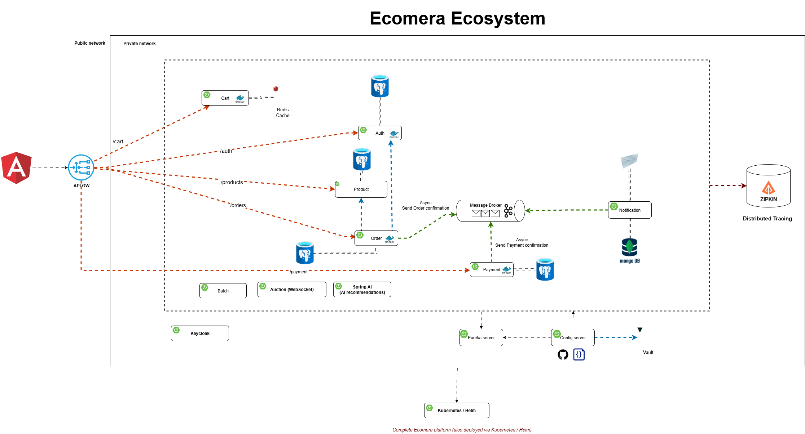

# Ecomera 🛍️

**Full-stack e-commerce platform: a journey from monolithic to microservices**

*Java · Spring Boot · Spring Cloud · Angular · Apache Kafka · Docker*

---

## About

Ecomera is a full-stack e-commerce platform that demonstrates the complete evolution from a **monolithic application** into a **distributed event-driven microservices architecture**. It showcases the full engineering lifecycle: domain-driven design, API-first development, event-driven communication, centralized configuration and security, automated CI/CD, and containerization.

---

## Architecture

> Diagram source: [`docs/architecture.drawio`](../docs/architecture.drawio) - edit with [draw.io](https://app.diagrams.net/) and re-export the PNG.

### Request flow

1. The **Angular SPA** talks exclusively to the **API Gateway**.
2. The **API Gateway** routes requests to the appropriate **microservice** (`/api/v1/**`) and centralizes CORS and authentication concerns.
3. Services resolve each other dynamically via **Eureka** and are configured centrally via **Spring Cloud Config Server** (secrets in **HashiCorp Vault**).
4. **Synchronous** inter-service calls use REST via **Spring Cloud OpenFeign**.
5. **Asynchronous** flows publish events to **Apache Kafka**; the **Notification Service** consumes them and dispatches confirmation emails (MailHog in dev).

---

## Repositories

### Monolithic Reference

| Repository | Description |
| --- | --- |
| [**ecomera-backend**](https://github.com/ecomera-ecosystem/ecomera-backend) | Original monolithic Spring Boot application - the reference starting point for the migration. |

### Business Microservices

| Repository | Description |
| --- | --- |
| [**ecomera-auth-service**](https://github.com/ecomera-ecosystem/ecomera-auth-service) | Authentication & authorization (registration, login, **JWT**). |
| [**ecomera-product-service**](https://github.com/ecomera-ecosystem/ecomera-product-service) | Product catalog & category management, inventory. |
| [**ecomera-cart-service**](https://github.com/ecomera-ecosystem/ecomera-cart-service) | Session-based shopping cart. |
| [**ecomera-order-service**](https://github.com/ecomera-ecosystem/ecomera-order-service) | Order creation, processing, and history. |
| [**ecomera-payment-service**](https://github.com/ecomera-ecosystem/ecomera-payment-service) | Mock payment processing & transaction history. |
| [**ecomera-notification-service**](https://github.com/ecomera-ecosystem/ecomera-notification-service) | Event-driven notifications via **Apache Kafka** + email delivery (**MongoDB** history). |

### Infrastructure & Platform

| Repository | Description |
| --- | --- |
| [**ecomera-api-gateway**](https://github.com/ecomera-ecosystem/ecomera-api-gateway) | **Spring Cloud Gateway** - unified entry point, routing, centralized CORS. |
| [**ecomera-eureka-service-registry**](https://github.com/ecomera-ecosystem/ecomera-eureka-service-registry) | **Eureka** service discovery & health monitoring. |
| [**ecomera-config-server**](https://github.com/ecomera-ecosystem/ecomera-config-server) | **Spring Cloud Config Server** - centralized configuration + **HashiCorp Vault** secrets. |
| [**ecomera-infrastructure**](https://github.com/ecomera-ecosystem/ecomera-infrastructure) | Docker Compose orchestration for the local infrastructure stack. |

### Client

| Repository | Description |
| --- | --- |
| [**ecomera-frontend**](https://github.com/ecomera-ecosystem/ecomera-frontend) | Angular application (auth, catalog/search, cart, checkout, payment, profile). |

### Organization

| Repository | Description |
| --- | --- |
| [**ecomera-ecosystem/.github**](https://github.com/ecomera-ecosystem/.github) | Centralized CI/CD workflows, org profile, and issue templates. |

---

## Technology Stack

### Backend
- **Java 17** + **Spring Boot 3.5** - microservice framework
- **Spring Cloud** - Gateway, Eureka, Config Server, OpenFeign, LoadBalancer
- **Spring Data JPA** + **PostgreSQL** (Liquibase migrations)
- **Redis** - distributed caching
- **MapStruct**, **Hibernate Envers** (auditing), **OpenAPI/Swagger**

### Security & Configuration
- **Spring Security** + **JWT**
- **HashiCorp Vault** - secrets management

### Messaging & Storage
- **Apache Kafka** - event-driven messaging
- **MongoDB** - notification history
- **PostgreSQL** - core relational data

### Frontend
- **Angular** + **TypeScript** + **Angular Material** + **Tailwind CSS**
- **Karma/Jasmine** testing

### DevOps
- **Docker** & **docker-compose**
- **GitHub Actions** - CI/CD
- **SonarCloud** / **JaCoCo** - code quality gates & coverage
- **JUnit / Mockito** - unit & integration testing

---

## Key Features

- **Independent microservices** - each business domain is autonomous and separately deployable
- **Service discovery** - dynamic registration via Eureka
- **API Gateway** - single entry point, routing, centralized CORS
- **Distributed configuration** - externalized config + Vault-managed secrets
- **Event-driven architecture** - Kafka for asynchronous notifications
- **Centralized security** - JWT authentication across the gateway & services
- **CI/CD** - automated build, test, and quality gates per service
- **Containerization** - every service ships as a Docker image

---

## Roadmap

Planned enhancements (tracked on the [project board](https://github.com/orgs/ecomera-ecosystem/projects/1)):

- **Spring Batch** - CSV product-import batch job
- **Kubernetes / Helm** - orchestration & deployment automation
- **Zipkin** - distributed tracing & observability
- **Keycloak** - OIDC/OAuth2 identity provider migration
- **Auction** - real-time bidding over WebSocket
- **Spring AI** - product recommendations

---

*Complete monolithic-to-microservices migration project*

**Java · Spring Boot · Spring Cloud · Angular · Kafka · Docker · Eureka · Config Server · Vault · Redis · PostgreSQL · MongoDB · SonarCloud**

